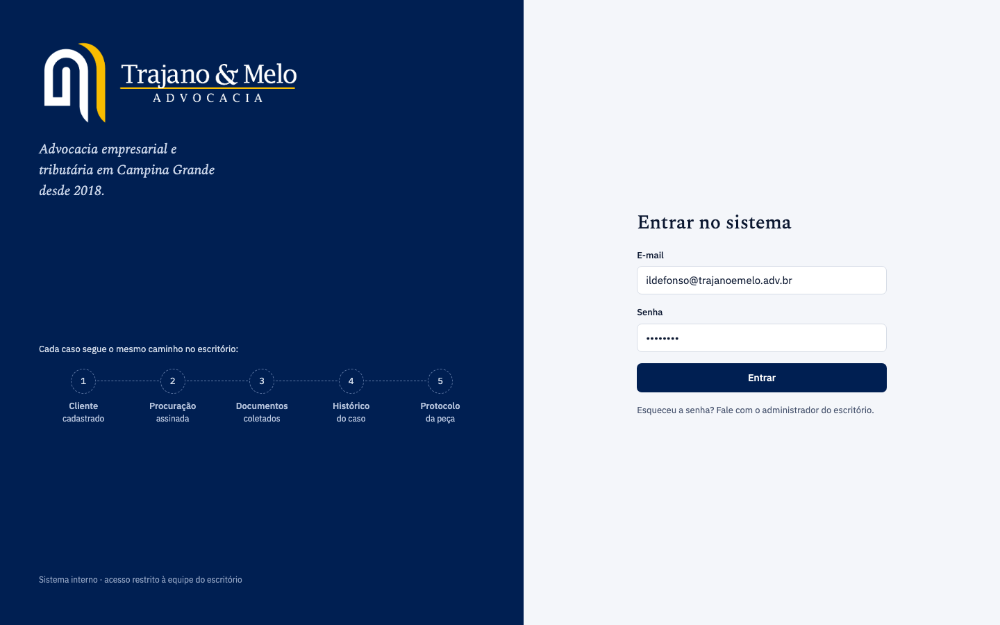
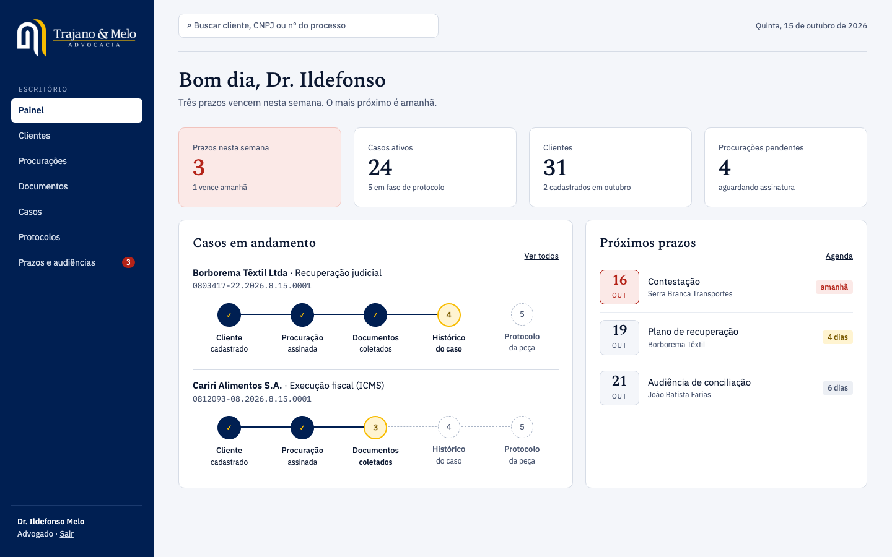
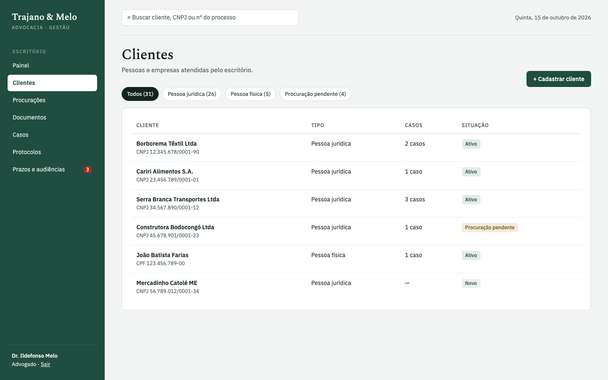
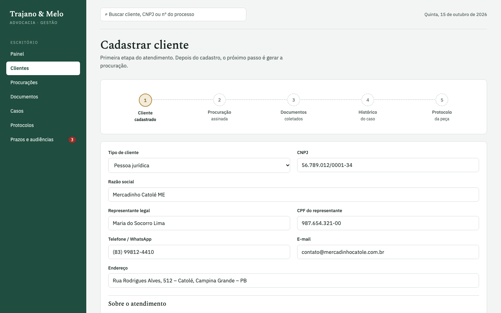
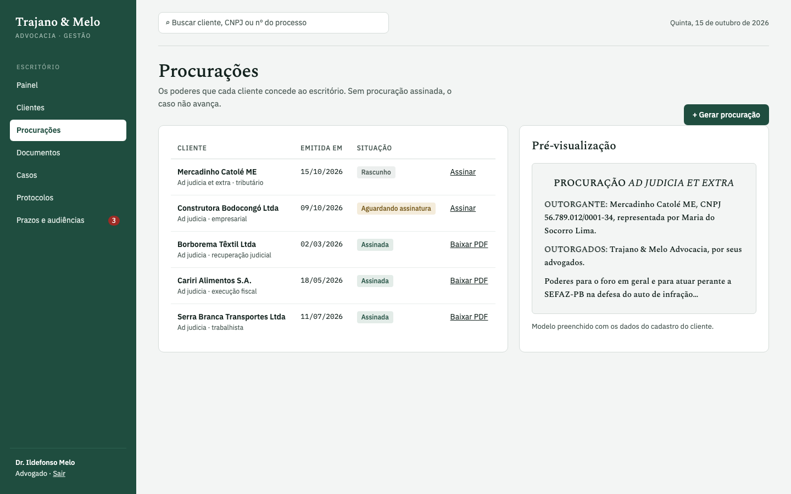
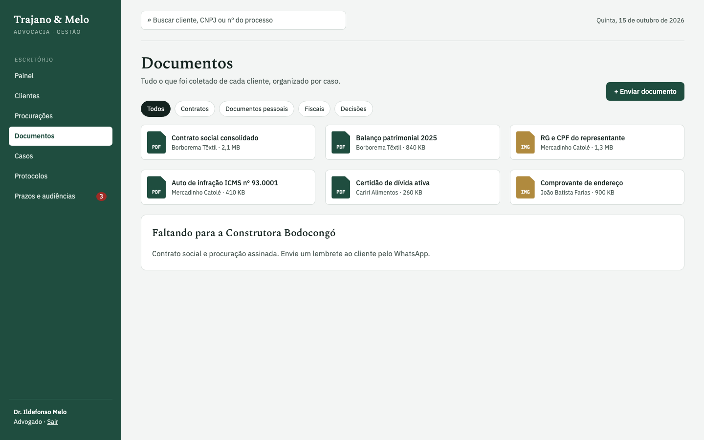
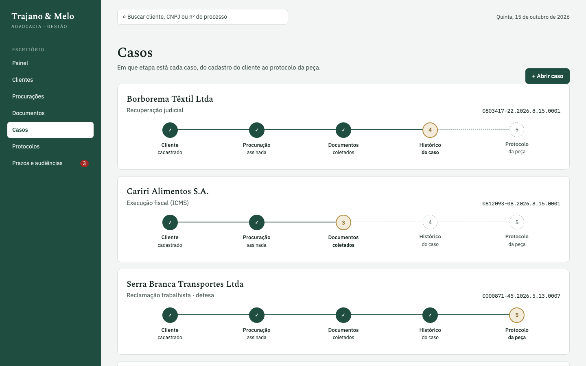
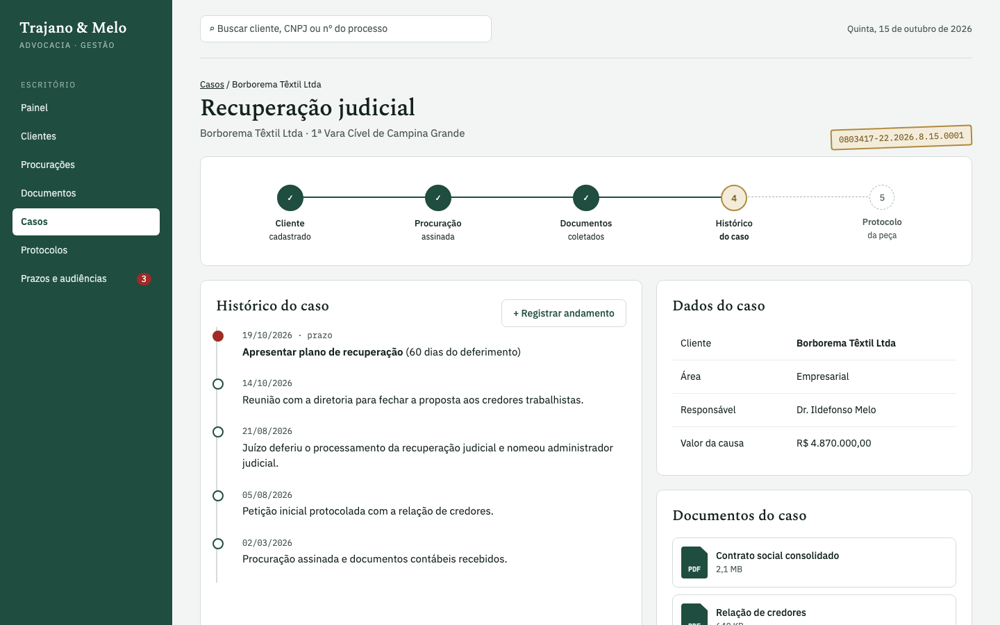
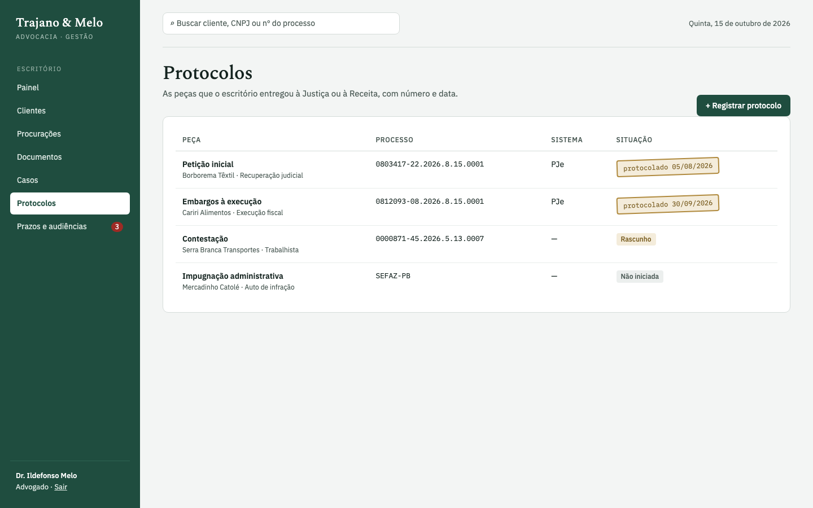
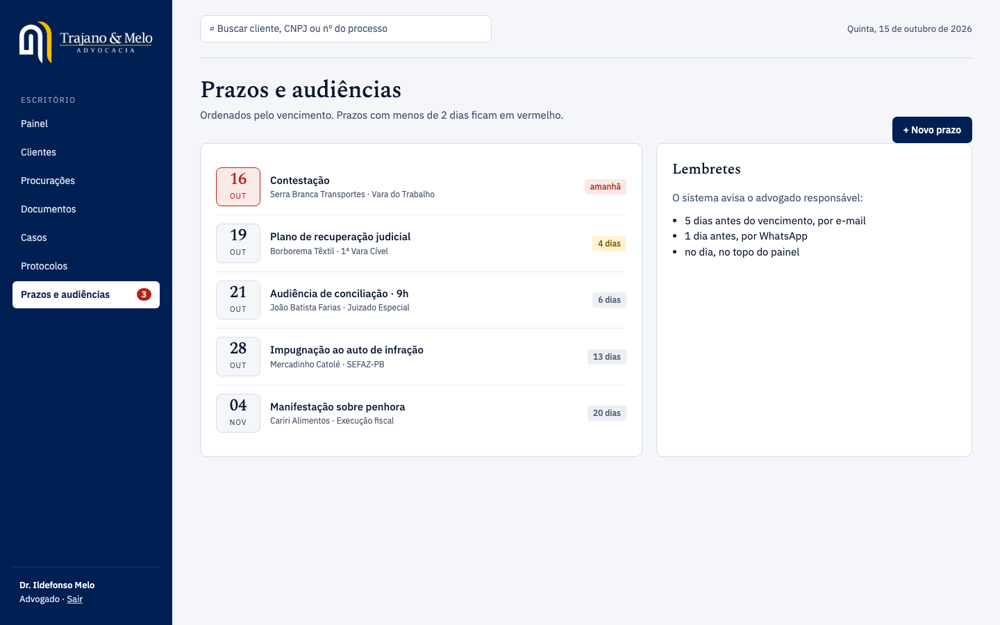

# Trajano & Melo – Gestão Jurídica

**Projeto Integrador I · Unifacisa · 2026**
**Alunos:** Rafael Barbosa e Ildefonso Melo
**Professor:** Daniel Abella

> **Entrega 1:** protótipo das telas, descrição do sistema e vídeo explicativo.

- 🖥️ **Protótipo navegável:** abra [`prototipo/index.html`](prototipo/index.html) (ou o link do GitHub Pages no topo do repositório)
- 🎬 **Vídeo de apresentação narrado (2 min 25 s):** [`video-apresentacao.mp4`](video-apresentacao.mp4)

---

## O problema

A **Trajano & Melo Advocacia** é um escritório de Campina Grande (PB), fundado em 2018, que atua com **direito empresarial e tributário**, além de questões trabalhistas e previdenciárias das empresas clientes.

Hoje o controle do escritório fica espalhado entre planilhas, pastas no computador e conversas de WhatsApp: quem é o cliente, se a procuração já foi assinada, quais documentos já chegaram, o que aconteceu no caso e, principalmente, **quando vence cada prazo**. Um prazo processual perdido significa prejuízo para o cliente e risco para o escritório.

## A solução

Um sistema web de gestão interna que segue o **caminho real de cada caso no escritório**, do jeito que ele acontece na prática:

```
1. Cliente      →  2. Procuração  →  3. Documentos  →  4. Histórico   →  5. Protocolo
   cadastrado       assinada          coletados         do caso           da peça
```

Cada caso mostra em qual dessas etapas está, e os prazos ficam sempre visíveis no painel.

## Quem usa

| Perfil | O que faz |
|---|---|
| **Administrador** | Cadastra usuários e acompanha todo o escritório |
| **Advogado** | Atende clientes, conduz os casos, registra andamentos e protocolos |
| **Cliente** *(fase futura)* | Consulta o andamento do próprio caso |

## Funcionalidades (telas do protótipo)

| # | Tela | O que faz |
|---|---|---|
| 01 | **Login** | Acesso restrito à equipe com e-mail e senha |
| 02 | **Painel** | Prazos da semana em destaque, indicadores e a etapa de cada caso |
| 03 | **Clientes** | Lista de empresas e pessoas atendidas, com filtros |
| 04 | **Cadastro de cliente** | Dados do cliente, representante legal e relato do primeiro atendimento |
| 05 | **Procurações** | Modelo de procuração preenchido com os dados do cliente e controle de assinatura |
| 06 | **Documentos** | Contratos, documentos pessoais e fiscais organizados por cliente e caso |
| 07 | **Casos** | Todos os casos com a etapa atual de cada um |
| 08 | **Histórico do caso** | Linha do tempo com reuniões, decisões e o próximo prazo |
| 09 | **Protocolos** | Peças protocoladas (PJe, SEFAZ-PB) com número e data |
| 10 | **Prazos e audiências** | Agenda ordenada pelo vencimento; menos de 2 dias aparece em vermelho |

## Telas

| | |
|---|---|
|  |  |
|  |  |
|  |  |
|  |  |
|  |  |

## Requisitos

**Funcionais**
- Autenticar usuários por e-mail e senha
- Cadastrar, editar e listar clientes (pessoa física e jurídica)
- Gerar procuração a partir dos dados do cliente e registrar a assinatura
- Anexar documentos ao cliente e ao caso
- Abrir casos e registrar andamentos no histórico
- Registrar protocolos de peças com número e data
- Cadastrar prazos e audiências e alertar o advogado responsável

**Não funcionais**
- Senhas guardadas com hash, nunca em texto puro
- Acesso só para usuários autenticados
- Interface responsiva (computador e celular)
- Alerta de prazo exibido no painel no dia do vencimento

## Tecnologias

| Fase | Tecnologias |
|---|---|
| **Fase 1 – protótipo (esta entrega)** | HTML e CSS, telas navegáveis sem funcionamento |
| **Fase 2 – sistema** | HTML, CSS e JavaScript no front-end · back-end com API · banco de dados MySQL |

## Como abrir o protótipo

Baixe o repositório e abra `prototipo/index.html` no navegador. Clique em **Entrar** para navegar pelas telas.

## Próximos passos (Fase 2)

1. Modelar o banco de dados MySQL (clientes, procurações, documentos, casos, andamentos, protocolos, prazos, usuários e perfis)
2. Implementar login com senha em hash e os cadastros (CRUD)
3. Ligar as telas do protótipo ao back-end
4. Lembretes de prazo por e-mail e WhatsApp

---

O documento com as instruções usadas para gerar as telas está em [`docs/instrucoes.md`](docs/instrucoes.md).
